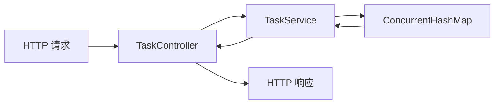

一个最小的 Hello World 服务很容易写出来。但当接口开始承载业务，代码很快就会遇到新的问题：请求处理和业务规则应该放在哪里？多个接口如何复用同一段逻辑？对象之间怎样建立依赖？

这一篇先不急着接数据库，也不引入缓存、消息队列或权限系统。我们从一个小型任务管理应用开始，只解决一件事：把 HTTP 请求、业务逻辑和数据操作组织成一条清楚的链路。

完成后，你将得到一组可以运行和验证的接口：

| 方法 | 路径 | 作用 |
|---|---|---|
| GET | `/tasks` | 查询全部任务 |
| GET | `/tasks/:id` | 查询指定任务 |
| POST | `/tasks` | 创建任务 |
| PUT | `/tasks/:id` | 更新任务 |
| DELETE | `/tasks/:id` | 删除任务 |

这里使用 Feat Cloud。开始前，请先按照 [Feat Cloud 快速开始](/feat/cloud/)创建 Maven 项目，并保留其中的 `feat-cloud` 运行期依赖和 `feat-cloud-starter` 编译期依赖。两个依赖必须使用相同的 Feat 版本。

## 先把项目结构定下来

我们把代码分成四个部分：

```text
src/main/java/com/example/tasks/
├── Bootstrap.java
├── controller/
│   └── TaskController.java
├── model/
│   └── Task.java
└── service/
    └── TaskService.java
```

每个类只承担一类责任：

- `TaskController` 负责 HTTP 路径、请求参数和响应。
- `TaskService` 负责任务的创建、查询、更新和删除。
- `Task` 表示业务数据。
- `Bootstrap` 负责启动应用。

这个划分不是要求每个项目都必须有固定的目录结构，而是让 HTTP 细节和业务逻辑先分开。项目变大后，你可以再按业务领域拆包。

## 定义任务数据

先定义一个简单的任务对象。它包含任务编号、标题和完成状态。

```java title="model/Task.java"
package com.example.tasks.model;

public class Task {
    private String id;
    private String title;
    private boolean completed;

    public Task() {
    }

    public Task(String id, String title, boolean completed) {
        this.id = id;
        this.title = title;
        this.completed = completed;
    }

    public String getId() {
        return id;
    }

    public void setId(String id) {
        this.id = id;
    }

    public String getTitle() {
        return title;
    }

    public void setTitle(String title) {
        this.title = title;
    }

    public boolean isCompleted() {
        return completed;
    }

    public void setCompleted(boolean completed) {
        this.completed = completed;
    }
}
```

这里保留了无参构造方法、字段和 getter/setter。对象既要能接收请求体中的 JSON 数据，也要能作为响应数据返回。Feat Cloud 的 POJO 响应序列化会使用对象属性的 getter。

## 把业务动作放进 Service

接下来创建 `TaskService`。它不应该知道 HTTP 路径，也不应该依赖 Controller。它只需要提供任务管理所需的业务方法。

为了让第一篇教程聚焦在应用结构上，这里暂时使用 `ConcurrentHashMap` 保存任务：

```java title="service/TaskService.java"
package com.example.tasks.service;

import tech.smartboot.feat.cloud.annotation.Bean;
import com.example.tasks.model.Task;

import java.util.ArrayList;
import java.util.List;
import java.util.Map;
import java.util.concurrent.ConcurrentHashMap;
import java.util.concurrent.atomic.AtomicLong;

@Bean
public class TaskService {
    private final Map<String, Task> tasks = new ConcurrentHashMap<>();
    private final AtomicLong sequence = new AtomicLong();

    public List<Task> findAll() {
        return new ArrayList<>(tasks.values());
    }

    public Task findById(String id) {
        return tasks.get(id);
    }

    public Task create(String title) {
        String id = String.valueOf(sequence.incrementAndGet());
        Task task = new Task(id, title, false);
        tasks.put(id, task);
        return task;
    }

    public Task update(String id, String title, boolean completed) {
        return tasks.computeIfPresent(id, (key, current) ->
                new Task(id, title, completed));
    }

    public boolean delete(String id) {
        return tasks.remove(id) != null;
    }
}
```

`@Bean` 告诉 Feat Cloud 这个类需要进入应用的 Bean 管理。它会在编译期被识别，并由生成的服务代码负责创建和装配。

这里使用并发 Map，只是为了让示例不依赖外部数据库。它有两个明确限制：应用重启后数据会消失；多实例运行时，每个实例的数据也不会自动同步。后面接入数据库时，我们会替换数据存储实现，而不是把 SQL 写进 Controller。

## 让 Controller 接收请求

现在把 Service 暴露成 HTTP 接口。

```java title="controller/TaskController.java"
package com.example.tasks.controller;

import com.example.tasks.model.Task;
import com.example.tasks.service.TaskService;
import tech.smartboot.feat.cloud.RestResult;
import tech.smartboot.feat.cloud.annotation.Autowired;
import tech.smartboot.feat.cloud.annotation.Controller;
import tech.smartboot.feat.cloud.annotation.PathParam;
import tech.smartboot.feat.cloud.annotation.RequestMapping;
import tech.smartboot.feat.cloud.annotation.RequestMethod;

import java.util.List;

@Controller
public class TaskController {
    @Autowired
    private TaskService taskService;

    public void setTaskService(TaskService taskService) {
        this.taskService = taskService;
    }

    @RequestMapping(value = "/tasks", method = RequestMethod.GET)
    public RestResult<List<Task>> findAll() {
        return RestResult.ok(taskService.findAll());
    }

    @RequestMapping(value = "/tasks/:id", method = RequestMethod.GET)
    public RestResult<Task> findById(@PathParam("id") String id) {
        Task task = taskService.findById(id);
        return task == null
                ? RestResult.fail("Task not found")
                : RestResult.ok(task);
    }

    @RequestMapping(value = "/tasks", method = RequestMethod.POST)
    public RestResult<Task> create(Task task) {
        if (task == null || task.getTitle() == null || task.getTitle().trim().isEmpty()) {
            return RestResult.fail("title is required");
        }
        return RestResult.ok(taskService.create(task.getTitle().trim()));
    }

    @RequestMapping(value = "/tasks/:id", method = RequestMethod.PUT)
    public RestResult<Task> update(@PathParam("id") String id, Task task) {
        if (task == null || task.getTitle() == null || task.getTitle().trim().isEmpty()) {
            return RestResult.fail("title is required");
        }
        Task updated = taskService.update(id, task.getTitle().trim(), task.isCompleted());
        return updated == null
                ? RestResult.fail("Task not found")
                : RestResult.ok(updated);
    }

    @RequestMapping(value = "/tasks/:id", method = RequestMethod.DELETE)
    public RestResult<String> delete(@PathParam("id") String id) {
        return taskService.delete(id)
                ? RestResult.ok("Task deleted")
                : RestResult.fail("Task not found");
    }
}
```

留意两个细节。

第一，`@Autowired` 标在字段上，而不是 setter 上。Feat Cloud 根据字段名 `taskService` 查找对应 Bean；这里提供同名、同类型的 setter，让编译期生成的代码直接完成注入。关于字段名匹配和注入顺序，可以继续阅读 [Bean 与依赖注入](/feat/cloud/bean/)。

第二，Controller 只负责把 HTTP 输入交给 Service，再把结果包装成 `RestResult`。任务如何生成编号、如何保存和删除，都留在 Service 中。这样以后把 Map 换成 MyBatis Mapper，Controller 的职责不需要跟着改变。

路径参数使用 `/:id`，通过 `@PathParam("id")` 读取。请求体中的自定义 POJO 则可以直接作为方法参数，Feat Cloud 会根据 JSON 请求体创建对象。更多请求绑定规则见 [Controller 与请求处理](/feat/cloud/controller/)。

## 启动应用

最后创建启动类：

```java title="Bootstrap.java"
package com.example.tasks;

import tech.smartboot.feat.cloud.FeatCloud;
import tech.smartboot.feat.cloud.annotation.Bean;

@Bean
public class Bootstrap {
    public static void main(String[] args) {
        FeatCloud.cloudServer().listen();
    }
}
```

执行：

```bash
mvn clean compile
```

这一步不能省略。Feat Cloud 的注解处理器在编译期解析 Controller 和 Bean，并生成运行时加载的服务代码。修改注解或编译期配置后，应重新构建，再启动应用。

然后在 IDE 中运行 `Bootstrap.main()`。默认服务端口为 8080。

## 验证这条业务链路

先创建一个任务：

```bash
curl -i -X POST http://localhost:8080/tasks \
  -H 'Content-Type: application/json' \
  -d '{"title":"学习 Feat Cloud"}'
```

响应中的任务会包含自动生成的 `id` 和初始状态 `completed: false`。假设返回的编号是 `1`，接下来可以查询：

```bash
curl http://localhost:8080/tasks
curl http://localhost:8080/tasks/1
```

更新任务：

```bash
curl -i -X PUT http://localhost:8080/tasks/1 \
  -H 'Content-Type: application/json' \
  -d '{"title":"完成 Feat Cloud 入门","completed":true}'
```

删除任务：

```bash
curl -i -X DELETE http://localhost:8080/tasks/1
```

如果这些请求都能得到预期结果，说明一条完整的业务链路已经建立：



这时，Feat Cloud 不再只是一个能返回 Hello World 的框架。你已经把请求入口、业务对象、依赖注入和数据操作组合成一个可以继续演进的应用。

## 这个示例没有解决什么

有意保持简单，不代表这些问题不重要。当前示例还有几个明确的边界：

- **数据持久化**：Map 中的数据只存在于当前进程。需要重启后保留数据时，继续阅读 [使用 MyBatis 持久化业务数据](/feat/cloud/mybatis/)。
- **并发与事务**：并发 Map 只保证单次 Map 操作的线程安全，不提供跨多步业务操作的事务语义。数据库写入和多表事务需要单独设计。
- **输入校验**：示例只检查标题是否为空。真实应用还需要根据业务规则限制长度、字符和状态变化。
- **身份认证与权限**：这里没有用户身份和访问控制。生产环境应结合安全实践设计认证、授权和会话边界。

## 下一步

你可以沿着下面的顺序继续完善应用：

1. 用 [使用 MyBatis 持久化业务数据](/feat/cloud/mybatis/)替换内存存储，增加持久化和事务处理。
2. 用 [启动配置与环境配置](/feat/cloud/options/)管理数据库地址、端口和不同环境的参数。
3. 阅读 [方法拦截器](/feat/cloud/interceptor/)，把日志、鉴权等公共逻辑从业务方法中分离。
4. 根据应用需要增加 [Session](/feat/cloud/session/) 和 [业务缓存](/feat/cloud/cache/)。
5. 最后阅读 [部署与交付](/feat/cloud/deployment/)和[安全实践](/feat/practices/security/)，准备交付。

如果你希望先理解刚才这些注解为什么能在运行时直接工作，可以回到[编译期工作模型](/feat/cloud/runtime/)。它解释了编译期如何把注解和配置转成运行时服务。
