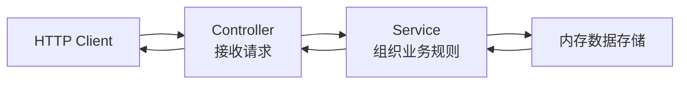

一个能返回字符串的接口，只能证明服务已经启动。真正的应用还需要回答更多问题：请求由谁接收，业务规则放在哪里，对象之间如何协作，数据如何保存，以及当应用规模扩大后，代码怎样继续保持清楚。

这一部分不按注解或 API 的字母顺序介绍功能，而是沿着一个应用逐步生长的过程展开。你会先完成一条最小业务链路，再按实际需要补上数据库、配置、会话、缓存和外部服务。

## 从一条业务链路开始

推荐先完成[构建第一个业务应用](/feat/building/first-business-application/)。

它使用 Feat Cloud 实现一个简单的任务管理 API。应用包含 Controller、Service 和 Bean 注入，但暂时不引入数据库。这样你可以先看清楚 HTTP 请求如何进入业务代码，以及业务对象如何被 Feat Cloud 连接起来。

当这条链路清楚之后，再把内存存储替换成持久化数据访问层。现有的 [MyBatis 集成](/feat/cloud/mybatis/)会继续带你完成 Mapper、数据库配置、CRUD 和事务边界。

## 按应用成长的顺序继续

| 当你需要…… | 阅读内容 |
|---|---|
| 定义 HTTP 接口、接收路径参数和请求体 | [Controller 与请求处理](/feat/cloud/controller/) |
| 把业务逻辑从 Controller 中拆出来 | [Bean 与依赖注入](/feat/cloud/bean/) |
| 组织响应数据和错误结果 | [返回值与错误响应](/feat/cloud/response/) |
| 管理不同环境的配置 | [启动配置与环境配置](/feat/cloud/options/) |
| 在请求之间保存少量状态 | [Session 与请求状态](/feat/cloud/session/) |
| 接入数据库并完成 CRUD | [MyBatis 集成](/feat/cloud/mybatis/) |
| 使用业务缓存 | [业务缓存](/feat/cloud/cache/) |
| 为多个接口增加公共逻辑 | [方法拦截器](/feat/cloud/interceptor/) |
| 把应用交付到目标环境 | [部署与交付](/feat/cloud/deployment/) |

这些文章各自回答一个问题，不需要在第一遍学习时全部读完。先完成业务，再根据遇到的实际问题进入对应章节。

## Core 与 Cloud 的选择

本部分以 Feat Cloud 为主，因为它提供了 Controller、Bean 和编译期装配等业务应用开发模型。如果你的目标是直接编写 HTTP 请求处理器，或需要更贴近网络运行时的控制能力，请从 [Feat Core 服务端](/feat/server/)开始。

无论选择哪条入口，底层 HTTP 运行能力都来自 Feat Core。Cloud 在此基础上提供业务组织方式；需要了解这些能力如何衔接时，再阅读[认识 Feat](/feat/guides/)和[编译期工作模型](/feat/cloud/runtime/)。
