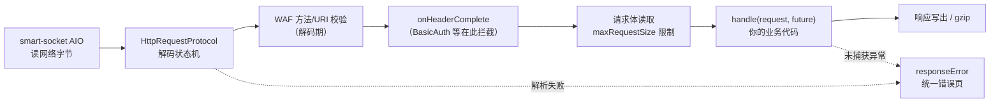

import { Aside, TabItem, Tabs } from '@astrojs/starlight/components';

这一页回答一个问题：**一个 HTTP 请求从网络字节到你的业务代码，中间发生了什么**。理解这条管线，ServerOptions 的每个参数、每个错误码、每个"反直觉"的行为就都有了出处。

## 全景图

整条管线跑在 smart-socket 的 AIO 回调线程上，没有 Servlet 容器、没有过滤器链、没有每请求一个线程。

## 第一站：解码状态机

`HttpRequestProtocol` 把 HTTP 报文解析实现为一个显式状态机，按阶段推进：

| 状态 | 做什么 | 失败时返回 |
|---|---|---|
| METHOD | 从字节树匹配请求方法 | —（空方法最终 501） |
| URI | 从路由字节树匹配 URI，WAF URI 校验 | 400 / WAF 405 |
| QUERY | 解析查询串 | 400 |
| PROTOCOL | 解析协议版本 | 400（不支持的版本） |
| HEADER | 逐行解析请求头 | 431（单个头超长） |
| BODY | 异步累积请求体 | 413（超过 maxRequestSize） |

两个值得注意的细节：

- **headerLimiter 的行为是"跳过"而不是"报错"**：超过上限的头部直接进入忽略状态，不参与后续处理。恶意超多头的请求不会得到 4xx，直接被静默丢弃
- **URI 超长返回 414**，协议版本解析用 8 字节 long 直接比较（`HTTP/1.1` 的字节恰好构成一个 long），一次比较完成版本判断，全程没有字符串分配

## 第二站：字节树缓存

Feat 性能的根基是 `ByteTree`：把 HTTP 报文里反复出现的内容（方法名、Header 名、协议版本、常见 Header 值）组织成字节前缀树，解码时按字节在树上匹配，命中即取回缓存的字符串对象，全程没有字符串分配和 HashMap 查找。

启动时 `HttpServer.initByteCache()` 会预热常用条目。另有一个公开的预留扩展点：`options.getUriByteTree()` 允许你把**完全固定的 URI** 提前注册到解码期——URI 在解码阶段就能命中并直接挂上处理器，连 Router 匹配都省掉。当前框架内置组件没有使用它，适合"路径完全固定、QPS 极高"的极端场景手动挂载。

注意区分两条路由路径：

- **Router 的路由匹配（含精确路由）发生在 `handle` 阶段**，用的是 Router 自己的 `NodePath` 前缀树
- 上述 `uriByteTree` 是解码期的可选旁路，不是 Router 的一部分

对使用者的意义：

- Router 匹配本身也是前缀树（不是逐条遍历），路由数量多不会线性变慢
- 自定义协议解析或高频字符串场景可以复用 `options.getByteCache()`

## 第三站：头部完成回调

所有请求头解析完成后，`onHeaderComplete` 被触发。这是一个**装饰器挂载点**：`BasicAuthServerHandler` 就是在这一层拦截的——认证失败时连接在这里被 401 关闭，根本不会进入业务 `handle`。WAF 的最终校验也在进入回调前完成。

理解这一层，你就明白 Feat 的安全原语为什么廉价：**能在解码期拒绝的请求，永远不会消耗业务逻辑**。

## 第四站：请求体与业务分发

- 请求体**异步累积**，`maxRequestSize` 在累积过程中检查，超限返回 413
- 头部带 `Host` 校验（HTTP/1.1 必须有 Host，缺失 400）
- 随后进入 `handle(request, future)`：
  - **同步路径**：你的处理器直接在 AIO 回调线程执行
  - **异步路径**：处理器立即返回，`future.complete(...)` 时才写响应——耗时操作必须走这条路径，原理见[异步处理](/feat/server/async/)

## 错误的统一出口

管线任何阶段抛出的 `HttpException`（含 `WafException`）都汇入 `responseError`，渲染统一的错误页。这就是为什么：

- 业务代码只需要抛异常，不需要自己写错误响应
- 错误页的形态全站一致（状态码 + 描述 + 版本签名）
- 解码期错误（如 Header 超长）也有与业务错误一致的表现

## 这套设计给你的使用边界

| 设计决策 | 对应的使用规则 |
|---|---|
| 缓冲区按池分配 | `readBufferSize` 至少容纳一个 URL 或 Header 值，否则解析直接失败 |
| headerLimiter 静默丢弃 | 不要依赖"超限报错"来发现头部滥用，监控要做在入口 |
| 精确路由解码期命中 | 极端热点可用 `uriByteTree()` 旁路；常规场景 Router 前缀树已足够快 |
| 同步 handler 占用 AIO 线程 | 超过 10ms 的操作走异步（见[性能调优](/feat/practices/performance/)） |
| gzip 在响应写出阶段 | 压缩阈值之下的响应不值得开 gzip（同上） |

