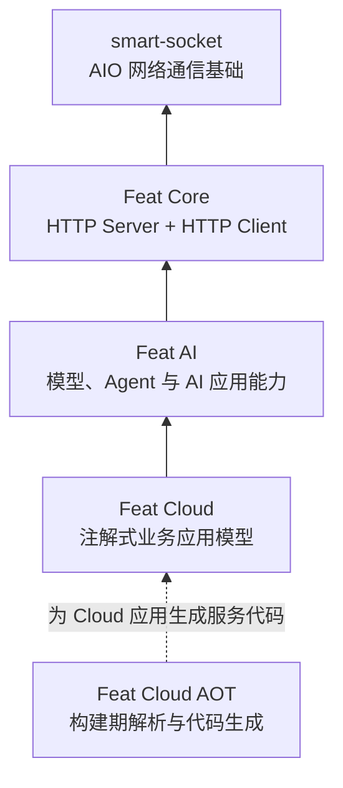

Feat 并不是把一个现成的 Java Web 框架换一种写法。它从网络服务运行时开始构建，再在这个基础上逐步提供 AI 能力和业务应用开发模型。

如果你已经熟悉 Java Web 开发，可能对下面这些事情并不陌生：一个很小的服务也要带上不少运行时依赖；框架启动时需要扫描类、解析注解、建立对象关系；当应用开始接入模型、工具和流式响应时，又要自己拼接 HTTP 请求、连接管理和业务代码。

Feat 关注的是这些问题之间的关系。它希望把网络执行、应用组织和 AI 能力放进同一套 Java 技术体系，同时尽量把能够提前确定的工作放到编译期完成。

## 先看整体关系

理解 Feat，先不要把它看成几个互不相关的 Maven 模块。它们之间有明确的依赖关系：

箭头表示模块依赖方向。AOT 则属于 Feat Cloud 的构建期工具链，不是一个需要在请求运行时额外经过的网络层。

**Feat Core** 提供 HTTP Server、HTTP Client、路由分发和请求处理等基础能力，底层网络通信建立在 smart-socket 之上。直接使用 Core 时，你可以更贴近 HTTP 请求和响应本身，决定服务如何组织、如何处理请求。

**Feat AI** 建立在 Core 之上。它把模型对话、流式输出、Embedding、Agent 和工具协作等能力带进 Java 应用。这里所说的面向 AI 时代，不是指框架代码由 AI 编写，而是让模型交互、工具调用和 Agent 协作成为 Java 应用可以直接组合的能力。它不是 Cloud 容器中的一个生命周期阶段。

**Feat Cloud** 依赖 Feat AI，并在其上提供更适合组织业务应用的开发模型，例如 Controller、Bean、依赖注入和配置。它让你可以用注解组织业务代码，同时保留 Feat 在编译期生成应用结构的设计路线。

Cloud AOT 负责把能够提前确定的应用信息放到构建阶段处理。它解析注解和配置，生成运行时需要的服务代码。运行时加载生成结果，而不是重新扫描注解来拼装整个应用。

## 该从哪里开始

不同目标不需要走同一条学习路线。先选一条能解决当前问题的入口，完成一个小应用，再回头理解更深的机制。

### 我想直接构建一个 HTTP 服务

从 [Feat Core 快速开始](/feat/server/) 开始。你会先接触 HTTP Server、请求处理器和 Router，再逐步理解请求生命周期、异步处理与协议能力。

适合希望掌握底层请求处理、开发轻量服务，或需要直接控制 HTTP 行为的开发者。

### 我想用注解组织业务应用

从 [Feat Cloud 快速开始](/feat/cloud/) 开始。先跑通 Controller，再学习请求绑定、Bean、配置和拦截器。完成基础开发后，可以继续阅读[构建第一个业务应用](/feat/building/first-business-application/)。

适合需要开发中大型 Java Web 应用、希望明确业务分层的开发者。

### 我想把 AI 能力接入 Java

从 [Feat AI 快速开始](/feat/ai/) 开始。先连接一个模型并拿到第一段响应，再根据需求学习 Agent、Embedding 和 Memory。若要把已有业务能力开放给 AI 工具调用，可以继续阅读 [MCP 服务](/feat/cloud/mcp/)。

### 我想从现有 Spring 项目迁移

先阅读[从 Spring Boot 迁移](/feat/practices/from-spring/)，理解两套框架在运行模型、注解和配置上的边界，再根据实际项目选择 Core 或 Cloud。不要把 Spring 的行为默认当成 Feat 的行为。

## 一条建议的完整阅读路线

如果你希望系统学习，而不是只查某个 API，可以按下面的顺序前进：

1. 认识 Feat，理解 Core、AI、Cloud 的依赖关系。
2. 选择 Core 或 Cloud，完成第一个可运行的 HTTP 应用。
3. 如果选择 Cloud，跟随[构建第一个业务应用](/feat/building/first-business-application/)把 Controller、Bean 和 Service 组合起来。
4. 需要持久化时，继续阅读 [MyBatis 集成](/feat/cloud/mybatis/)；需要会话、缓存或外部服务时，再进入对应章节。
5. 应用跑通后，回到[请求处理管线](/feat/guides/architecture/)和[编译期工作模型](/feat/cloud/runtime/)，理解框架如何执行。
6. 最后根据交付目标学习测试、安全、性能和部署。

文档不要求你从头读到尾。每篇文章会围绕一个问题展开；遇到需要深入的机制，再沿着文中的链接进入对应章节。

## 开始之前

Feat 各模块采用 Apache 2.0 开源协议。赞助是对项目维护和生态建设的自愿支持，不是使用 Feat 或 Feat Cloud 的前置条件。项目背景和支持方式见[赞助支持](/feat/sponsors/)。

如果你已经确定了开发入口，可以直接开始：

- [Feat Core：构建 HTTP 服务](/feat/server/)
- [Feat Cloud：构建业务应用](/feat/cloud/)
- [Feat AI：接入模型与 Agent](/feat/ai/)
