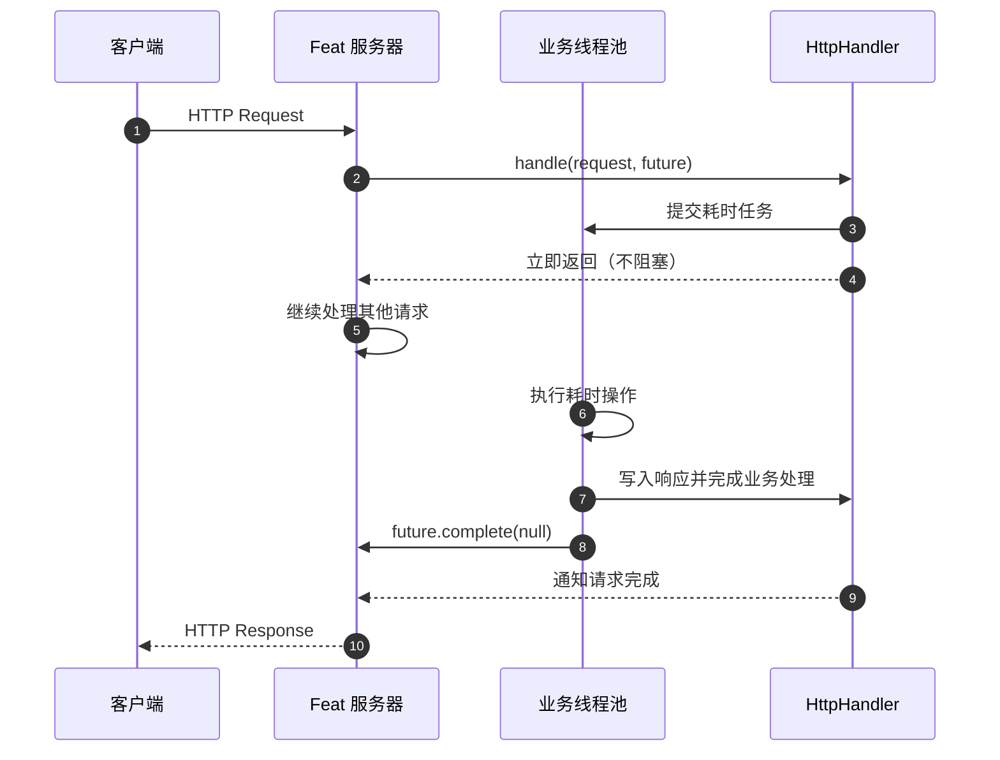

import { Aside } from '@astrojs/starlight/components';

Feat Core 基于 AIO 处理网络 I/O。同步处理器会在当前请求处理调用链中执行；如果在其中执行阻塞式数据库访问、远程调用或文件操作，就会占用执行该请求的线程。对于这类阻塞任务，可以把业务工作提交到应用管理的线程池，再通过完成回调通知 Feat。

是否需要异步，不应由一个固定的毫秒数决定。更重要的是操作是否会阻塞、线程是否需要隔离，以及应用能否接受额外的线程切换和异步编排成本。

## 同步与异步的区别

| 特性 | 同步处理 | 异步处理 |
|------|---------|---------|
| 业务代码执行位置 | 当前请求处理线程 | 由应用选择的执行器或回调线程 |
| 阻塞影响 | 阻塞当前执行线程 | 提交任务后可释放当前处理调用 |
| 适用场景 | 快速、非阻塞的处理逻辑 | 需要隔离的阻塞操作或异步任务 |
| 代码复杂度 | 较低 | 需要管理任务执行与 CompletableFuture |

<Aside type="tip">
选择时先看操作本身：快速的内存计算通常直接同步完成；阻塞式数据库访问、外部 API 调用或文件操作，则应考虑线程隔离。若所用客户端本身提供非阻塞 API，也可以组合异步结果，而不必再套一层线程池。
</Aside>

## 异步处理模型

Feat 的异步处理依赖 `HttpHandler` 接口的双参数方法：

```java
void handle(HttpRequest request, CompletableFuture<Void> future)
```

如果使用 Feat Core 的 Router，异步处理器需要实现 `RouterHandler`，并重写 `handle(Context, CompletableFuture<Void>)`；单参数 Lambda 对应的是同步处理。具体写法见 [Router 异步路由处理器](/feat/server/router/)。

使用 `HttpHandler` 的异步模式只需做两件事：

1. **决定业务任务由哪个执行器或异步 API 执行**。
2. **在响应处理完成后调用 `future.complete(null)` 通知 Feat**。

<Aside type="caution">
如果忘记调用 `future.complete(null)`，请求将一直挂起，客户端收不到响应。
</Aside>

## 基础用法

### 创建异步处理器

```java
import tech.smartboot.feat.Feat;
import tech.smartboot.feat.core.server.HttpHandler;
import tech.smartboot.feat.core.server.HttpRequest;

import java.util.concurrent.CompletableFuture;
import java.util.concurrent.ExecutorService;
import java.util.concurrent.Executors;
import java.util.concurrent.RejectedExecutionException;

public class AsyncDemo {
    public static void main(String[] args) {
        // 创建业务线程池
        ExecutorService executor = Executors.newFixedThreadPool(4);

        Feat.httpServer()
            .httpHandler(new HttpHandler() {
                @Override
                public void handle(HttpRequest request, CompletableFuture<Void> future) {
                    try {
                        executor.execute(() -> {
                            try {
                                // 模拟耗时操作
                                Thread.sleep(100);
                                request.getResponse().write("Async response");
                            } catch (Exception e) {
                                request.getResponse().setHttpStatus(500);
                                request.getResponse().write("Internal error");
                                e.printStackTrace();
                            } finally {
                                // 业务任务结束后通知 Feat
                                future.complete(null);
                            }
                        });
                    } catch (RejectedExecutionException e) {
                        // 任务未能提交，也必须结束本次请求
                        request.getResponse().setHttpStatus(503);
                        request.getResponse().write("Service unavailable");
                        future.complete(null);
                    }
                }

                @Override
                public void handle(HttpRequest request) {
                    // 异步模式下这里不处理主逻辑
                }
            })
            .listen(8080);
    }
}
```

### 简化写法

如果不需要复杂的线程池管理，可以按同样的模式组织异步处理器： 这里省略了 Executor 参数，因此任务会使用 `ForkJoinPool.commonPool()`；这适合演示，不代表所有业务都应该共用默认线程池。

```java
Feat.httpServer()
    .httpHandler(new HttpHandler() {
        @Override
        public void handle(HttpRequest request, CompletableFuture<Void> future) {
            CompletableFuture.supplyAsync(() -> {
                // 耗时操作
                return fetchDataFromDatabase();
            }).whenComplete((result, error) -> {
                try {
                    if (error != null) {
                        request.getResponse().setHttpStatus(500);
                        request.getResponse().write("Internal error");
                    } else {
                        request.getResponse().write(result);
                    }
                } finally {
                    // 成功或失败都要结束请求，避免客户端一直等待
                    future.complete(null);
                }
            });
        }

        @Override
        public void handle(HttpRequest request) {
        }
    })
    .listen(8080);
```

## 回调触发流程

以下泳道图展示了异步请求的处理流程：



**流程说明：**

1. **接收请求** - Feat 的网络处理流程完成请求解析
2. **调用处理器** - 调用 `handle(request, future)` 方法
3. **提交任务** - 将阻塞式业务操作提交到应用线程池
4. **返回处理调用** - 处理器返回后，Feat 可以继续推进其他可处理的工作
5. **异步执行** - 业务线程池执行耗时操作
6. **完成通知** - 调用 `future.complete(null)` 通知 Feat 请求完成
7. **发送响应** - Feat 将响应发送给客户端

## 完整示例

### 数据库查询场景

```java title="AsyncDatabaseDemo.java"
import tech.smartboot.feat.Feat;
import tech.smartboot.feat.core.server.HttpHandler;
import tech.smartboot.feat.core.server.HttpRequest;

import java.util.concurrent.CompletableFuture;
import java.util.concurrent.ExecutorService;
import java.util.concurrent.Executors;

public class AsyncDatabaseDemo {
    // 业务线程池
    private static final ExecutorService executor = Executors.newFixedThreadPool(8);
    
    public static void main(String[] args) {
        Feat.httpServer(options -> options.debug(true))
            .httpHandler(new HttpHandler() {
                @Override
                public void handle(HttpRequest request, CompletableFuture<Void> future) {
                    String userId = request.getParameter("id");
                    
                    executor.execute(() -> {
                        try {
                            // 模拟数据库查询
                            User user = queryDatabase(userId);
                            
                            if (user != null) {
                                request.getResponse().write(
                                    "{\"id\":\"" + user.id + "\",\"name\":\"" + user.name + "\"}"
                                );
                            } else {
                                request.getResponse().setHttpStatus(404);
                                request.getResponse().write("User not found");
                            }
                        } catch (Exception e) {
                            request.getResponse().setHttpStatus(500);
                            request.getResponse().write("Internal error");
                            e.printStackTrace();
                        } finally {
                            // 无论成功失败，都要完成 future
                            future.complete(null);
                        }
                    });
                }

                @Override
                public void handle(HttpRequest request) {
                }
            })
            .listen(8080);
    }
    
    static User queryDatabase(String userId) throws InterruptedException {
        // 模拟数据库查询耗时
        Thread.sleep(50);
        return new User(userId, "User_" + userId);
    }
    
    static class User {
        String id, name;
        User(String id, String name) {
            this.id = id; this.name = name;
        }
    }
}
```

### 外部 API 调用场景

```java title="AsyncHttpCallDemo.java"
import tech.smartboot.feat.Feat;
import tech.smartboot.feat.core.server.HttpHandler;
import tech.smartboot.feat.core.server.HttpRequest;

import java.util.concurrent.CompletableFuture;
import java.util.concurrent.ExecutorService;
import java.util.concurrent.Executors;

public class AsyncHttpCallDemo {
    private static final ExecutorService executor = Executors.newFixedThreadPool(4);
    
    public static void main(String[] args) {
        Feat.httpServer()
            .httpHandler(new HttpHandler() {
                @Override
                public void handle(HttpRequest request, CompletableFuture<Void> future) {
                    executor.execute(() -> {
                        try {
                            // 调用外部 API
                            String result = callExternalApi();
                            request.getResponse().write(result);
                        } catch (Exception e) {
                            request.getResponse().setHttpStatus(502);
                            request.getResponse().write("External service error");
                        } finally {
                            future.complete(null);
                        }
                    });
                }

                @Override
                public void handle(HttpRequest request) {
                }
            })
            .listen(8080);
    }
    
    static String callExternalApi() throws InterruptedException {
        // 模拟 HTTP 调用耗时
        Thread.sleep(200);
        return "{\"status\":\"ok\",\"data\":[]}";
    }
}
```